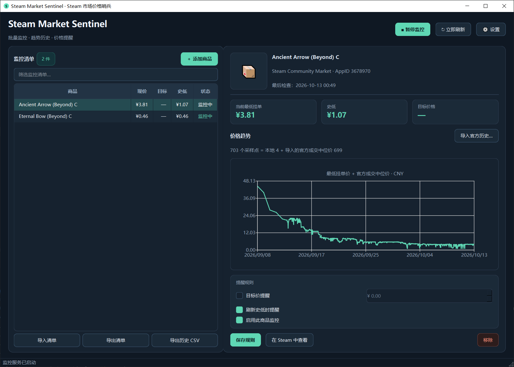

# Steam Market Sentinel

**A cross-game Steam Community Market price watcher** · local-first desktop tool

[简体中文](README.md) · [Changelog](CHANGELOG.md) · [Contributing](CONTRIBUTING.md)

[](https://github.com/LaoZhuJackson/Steam-Market-Sentinel/actions/workflows/ci.yml)


[](LICENSE)

Search the Steam Community Market, watch the **lowest sell listing price** for many items at once, keep a local price history, and get notified when a price hits your target or sets a **new all-time low**. **No Steam account, password or API key required.**

Works with any AppID that has Community Market items — CS2, Dota 2, TF2 and more.

> [!NOTE]
> This is **v0.2.0**. The repository can build a Windows executable (including a single-file exe), but **no signed, network-verified installer is published**. This is an independent community project, not affiliated with Valve / Steam, and it uses Steam's undocumented public endpoints — they may rate-limit or change shape at any time. Keep request rates conservative.

## Screenshot



On the left, the filterable watchlist; on the right, the selected item's price trend — the **lowest asking price** the app polls for and the **median sale price** imported from your browser are merged into a single line, with a note above the chart saying how many points come from each.

## Contents

- [Screenshot](#screenshot)
- [Features](#features)
- [Install and run](#install-and-run)
- [Usage](#usage)
- [Notifications](#notifications)
- [Settings](#settings)
- [Price definitions, privacy and data](#price-definitions-privacy-and-data)
- [FAQ](#faq)
- [Development and contributing](#development-and-contributing)
- [References](#references)

## Features

- **Compact PySide6 dark UI** — filterable watchlist table, item thumbnails, price chart, system tray.
- **One input to add an item** — paste a market listing URL and it resolves instantly, or type a keyword and pick from the results. Both share a single input box, so there is no longer a "which search box do I fill in?" question.
- **Cross-game search** — optionally scope by AppID (CS2 `730`, Dota 2 `570`, TF2 `440`, …), or use `0` to search every game.
- **Batch polling** — items are polled one by one, with separate cycle-interval and per-item spacing; rate limits and network errors back off and retry, and one failing item never aborts the cycle.
- **Two alert rules** — ① notify once when `price <= target`, re-arming only after the price leaves the threshold; ② notify when the price strictly beats the lowest listing observed since tracking began (the first sample only establishes a baseline and does not alert).
- **Multiple notification channels** — desktop tray popups, QQ Mail SMTP, and OneBot v11 private messages (e.g. via NapCat). They can be enabled together.
- **Local history and export** — SQLite snapshots of the lowest sell listing; JSON watchlist import/export and UTF-8 BOM CSV history export, either of which can be limited to the **ticked items**.
- **Switchable quote currency** — CNY / USD / EUR, each kept as an independent series.
- **Official sales history you can import and keep** — Steam's **median sale price** curve is only served to a browser session, and the app never asks for or stores credentials. So there is an "导入官方历史…" (import) action: run one line in the item page, paste the result, and it is **stored for good and merged into that item's observed curve** (one line; the two are different quantities — see "Price definitions" below).
- **Secrets stay in the OS keyring** — the QQ Mail authorization code and OneBot access token go through `keyring`, never into `settings.json`.

## Install and run

**Requirements:** Python 3.10+; Windows 10/11 recommended. Linux / macOS should work, but tray and desktop notifications need a desktop environment.

### Option 1: conda

```bash
git clone https://github.com/LaoZhuJackson/Steam-Market-Sentinel.git
cd Steam-Market-Sentinel
conda create -n steam-market python=3.11 -y
conda activate steam-market
pip install -r requirements.txt   # run from the repo root: the file ends with -e .
python main.py
```

### Option 2: venv

```powershell
git clone https://github.com/LaoZhuJackson/Steam-Market-Sentinel.git
cd Steam-Market-Sentinel
python -m venv .venv
.\.venv\Scripts\Activate.ps1
python -m pip install -r requirements.txt
python main.py
```

If PowerShell blocks `.ps1` execution, skip activation and call the interpreter directly:

```powershell
.\.venv\Scripts\python.exe -m pip install -r requirements.txt
.\.venv\Scripts\python.exe main.py
```

Linux / macOS:

```bash
python3 -m venv .venv && source .venv/bin/activate && pip install -r requirements.txt && python main.py
```

`requirements.txt` covers both runtime and development dependencies (pytest / ruff / pyinstaller) and works in conda and venv environments alike. To install runtime dependencies only, use `pip install .` instead.

Once it starts, click **＋ 添加商品** ("Add item") to begin — see below.

## Usage

### Adding an item

Click **＋ 添加商品**, then use the **single** input box in either way:

- **Paste a market listing URL** (easiest): e.g.
  `https://steamcommunity.com/market/listings/730/AK-47%20%7C%20Redline`.
  It is parsed immediately into that item's AppID and `market_hash_name` — no search, no manual AppID —
  and still shows up as a result row, so the list always mirrors the current candidate.
- **Type a keyword**: e.g. `AK-47`, `Revolution Case`. Optionally narrow by AppID first using the game filter (`0` searches all games). Press Enter or click "Search" and the **first result is selected automatically**.

Either route funnels into the same "will be added" summary card. The Add button stays disabled until a concrete item is selected, so you can no longer fill in the wrong box. You can also tick "enable target price" and set a threshold at the same time.

After adding, the poller fetches prices and the right-hand panel shows the thumbnail and the local price chart. Items **added by pasting a link start without an image**; selecting one makes the app read the thumbnail from its item page once (a failure just leaves the placeholder rather than reporting an error). Thumbnails are **cached on disk** (in `thumbs/` under the data directory), so switching items — or restarting the app — never re-downloads them.

### Monitoring and alert rules

Select an item in the watchlist to edit its rules on the right:

| Rule | Behaviour |
|---|---|
| Target price alert | Notifies once when `price <= target`; it re-arms only after the price moves back above the threshold. Editing the target re-arms it immediately. |
| Alert on a new all-time low | Notifies when the price strictly beats the previous all-time low. **The first sample only establishes a baseline and does not alert.** |
| Enable monitoring for this item | Unchecking pauses polling; the existing local history is kept. |

Rule edits **save immediately** — there is no Save rule button, because editing a target and then switching items used to lose it. Ticking a rule or typing a price now takes effect at once and the **target price** figure updates with it. Ticking "target price alert" while the value is still 0 seeds it from the current price (a target of 0 can never fire).

You can also edit the **display name**: Chinese is fine, it only affects the local label and **never changes the item name on Steam**; clearing it falls back to the market name.

**Remove** moved into the watchlist — each row ends with a **×** that removes that item (deleting its local history too, so export first; the confirmation names the item).

Open the item page with **View on Steam** inside the "导入官方历史…" dialog — the import flow requires opening that page in your browser anyway, so it belongs to the same step.

Every row also has a **tick box**, next to **全选** / **清除全选** (select all / clear) above the list: **Export watchlist** and **Export history CSV** then cover **only the ticked items** (with nothing ticked they fall back to everything, and the status bar says so). Ticks survive the polling refresh.

Settings additionally has a **global** switch, "**Notify when the price drops**": it notifies whenever this cycle's lowest price is below the previous local sample. It is independent of the two rules above and unaffected by the all-time low — after importing an official history it is usually more useful than "new all-time low".

**Why the curve barely seems to move**: a sample is stored only when the **price changes** or every **6 hours** (a heartbeat), so a stable price does not grow a new point every cycle — that is deliberate, to bound database size. **Last checked** updates on every successful poll, which is how you confirm monitoring is actually running, while **last sampled** only advances when a sample is really written. The two differing is normal.

**Reading the curve**: **hovering any data point** shows its timestamp and price. Dense series (e.g. a few hundred imported official points) drop the marker dots so they do not merge into a blob, while sparse ones keep them — a lone point draws no line, so it needs its marker. If the window is too short, the detail panel scrolls rather than squashing the chart.

The app **remembers the selected item** and reopens on the same view (imported official history lives in the local database, so it is never lost). There is one price chart: local samples and any imported official history are shown merged, not as two switchable modes.

The filter box above the watchlist narrows it by name; **Refresh now** starts the next cycle as soon as the current one finishes.

### Importing the official sales history

Alongside the **lowest asking price** it polls itself, the app can import Steam's official **median sale price** history, which is merged into the same line (see below). Steam only serves that data to a **logged-in** session: while anonymous, the identical request returns **HTTP 400** (verified from this app *and* from a browser console on the item page). The app deliberately never asks for or stores Steam credentials, so it is obtained **once from your browser** and imported:

1. **Log in to Steam in your browser**, then open the item's market page (without logging in you will always get 400) — the dialog's "在 Steam 中查看" button opens it for you.
2. Press **F12 → Console**, paste the snippet below and hit Enter (the "导入官方历史…" dialog has a "复制浏览器脚本" button that copies it for you).
3. The script copies the result to your clipboard — paste it into the dialog (or save it to a file and use "从文件读取…"), then click import.

Your login lives only in your browser; the snippet makes one same-origin request with your own session, and **that credential never enters this program**, which will not log in on your behalf.

```js
(() => {
  const p = location.pathname.split('/').filter(Boolean);   // market/listings/<appid>/<name>
  if (p[0] !== 'market' || p[1] !== 'listings') { console.warn('Run this on a Steam market item page'); return; }
  const url = `/market/pricehistory/?appid=${p[2]}&market_hash_name=${encodeURIComponent(decodeURIComponent(p[3]))}&currency=23&country=CN`;
  fetch(url).then(r => r.text()).then(t => {
    console.log('URL:', url); console.log('response:', t);
    try { copy(t); console.log('copied - paste it into the app'); }
    catch (e) { console.warn('clipboard unavailable, copy the "response" line above manually'); }
  });
})()
```

It derives the AppID and item name from the **current page URL**, so it works for any item; the same-origin `fetch` carries the page's own session, so **no credential ever reaches this program**.

The trailing `&currency=23&country=CN` requests **CNY** quoting (the app's "复制浏览器脚本" fills in whichever currency you have configured). What was actually measured: **once logged in, the currency follows your Steam account** — even with the browser behind a Singapore proxy node showing S$ while anonymous, the logged-in response came back in ¥. The app always labels the series from the response's own `price_prefix`, so neither case can be mislabelled and **no currency conversion is needed** (nor does the app do any: the same number in two currencies is not the same thing, and Steam's regional pricing and fees cannot be reproduced from an exchange rate).

Imported prices are in **whatever currency the response used**, named in the chart title. If that currency differs from your current setting the import is **refused with an explanation** — drawing two currencies as one line would be wrong, and with a single merged view there is nowhere honest to show it, so you are asked to switch currency first. Re-importing replaces the series.

> [!IMPORTANT]
> **What merging means.** Local samples are the **lowest asking price** (what sellers ask); the official data is the **median sale price** (the median of what actually traded). They differ systematically. After merging:
> - the **all-time low** column takes the minimum of the merged series, so it **may come from the official data**;
> - the **new-all-time-low alert** baseline becomes that merged low, so if the imported history contains a point far below today's asking price, the current price can **never** trigger that alert again (e.g. a history low of ~¥1.07 against ~¥4 today);
> - the **current price** column still comes from local samples only;
> - the CSV export gains a `source` column (`local` / `official`) so the two are never silently mixed.
>
> **The fix for this**: if what you actually want is "tell me whenever it gets cheaper", turn on **"Notify when the price drops"** in Settings — it compares against the **previous local sample** and never looks at the historical low, so importing history cannot switch it off.
>
> If you would rather the **alerts looked at local samples only** (while the all-time-low column still shows the merged result), say so — it is a one-place change to the comparison baseline.

## Notifications

Settings has three tabs: General, QQ Mail, QQ Bot. All three channels can be enabled at once.

| Channel | What it needs | Trade-off |
|---|---|---|
| Desktop tray popup | Nothing to configure | Most immediate, but easy to miss while away |
| QQ Mail SMTP | A QQ mailbox plus an **SMTP authorization code** (not the QQ password) | Reaches you remotely; may be delayed or land in spam |
| OneBot v11 private message | A locally deployed compatible service (e.g. NapCat) | Delivers straight to QQ, but you maintain the bot service |

Tray + QQ Mail is the recommended combination.

**QQ Mail**: enable SMTP in the QQ Mail web settings and get an **authorization code**, then fill in sender, recipient (blank means send to yourself) and the code, and click "Save code and send test mail". The app uses `smtp.qq.com:465` (SSL).

**QQ Bot / OneBot v11**: provide the HTTP root URL (e.g. `http://127.0.0.1:3000`, **without** `/send_private_msg`), the recipient QQ number, and an optional access token. The app only posts OneBot v11 `POST /send_private_msg`; it does not provide QQ login or a NoneBot service, so you need to run a compatible environment yourself. Remote public URLs **must** use HTTPS so the token is never sent in cleartext.

> [!IMPORTANT]
> The authorization code and access token are stored only in the OS credential store (Windows Credential Manager / macOS Keychain / Secret Service). If no secure backend is available, the app **does not** fall back to a plaintext file — it reports the failure instead.

## Settings

| Option | Default | Notes |
|---|---|---|
| Quote currency | CNY | Queries the lowest sell listing in that currency; each currency is stored separately |
| Cycle interval | 15 minutes | How long to wait between cycles over all enabled items; 1–1440 minutes, too short invites rate limiting |
| Per-item gap | 6 seconds | Delay between individual item requests; 3–120 seconds |
| Start monitoring on launch | On | Begins working in a background thread |
| Minimize to tray on close | On | The process only exits via "Quit" in the tray menu |
| Show desktop tray notifications | On | Needs a desktop environment with notification support |
| Notify when the price drops | **Off** | Notifies whenever this cycle's lowest price is below the **previous local sample**. It compares against local samples, so it keeps working after an official history is imported (see the price-definitions notes) |
| Notify on monitoring failures | **On** | Notifies once when an item starts failing (usually the network cannot reach Steam) and once when it recovers; while it is failing the poller **retries sooner** instead of buzzing you every cycle |
| QQ Mail / QQ Bot | Off | Requires you to configure a code or a compatible bot service |

**Batch monitoring is not a real-time feed**: watching 100 items with a 6-second gap means one cycle alone takes at least ~10 minutes before network and rate-limit time. The cycle interval is the wait **between** cycles, not a per-item refresh guarantee.

**Monitoring recovers by itself**: if anything failed in a cycle, the next one comes **2 minutes** later instead of waiting the full interval — so reconnecting or switching on your proxy needs no button press. The first successful poll clears the 异常 state back to 监控中 and sends one "monitoring recovered" notice, if notifications are enabled.

## Price definitions, privacy and data

This is the most important caveat in the project.

### About "all-time low"

Steam's `priceoverview` `lowest_price` is the **lowest current seller listing price** — it does not contain the full historical lowest-asking-price record. Steam's `pricehistory` usually requires a logged-in session and reports **median prices of completed sales with volumes**, a completely different quantity. To avoid passing sales history off as an asking-price low, the app:

- stores the lowest asking prices observed since tracking began in local SQLite, for the local trend and the "new all-time low" alert. The column labelled **all-time low** means the lowest value *you* have observed (including any imported history) — it is **not** Valve's platform-wide all-time low, so please do not treat the two as the same thing;
- treats official sales history as a separate, optional view: Steam asks for it with a **session cookie** (which is why your browser can show it) and the app **never requests or stores** Steam cookies, so instead it is imported once through the browser into its own table. On import it is **merged into that item's observed curve**, so it does take part in the **all-time low** and the new-low comparison; the **current price** still comes from local samples only, and the CSV export tags every row with `source`;
- only sees the quote at each poll, so it cannot catch lows between polls. Even after an alert, an item may sell out or change price before you open the link — **the app never purchases anything**;
- compares your target against the price Steam shows buyers including applicable fees, so check the currency and fee basis yourself.

### Local data

| Platform | Path |
|---|---|
| Windows | `%APPDATA%\SteamMarketSentinel\sentinel.sqlite3` and `settings.json` |
| Linux / macOS | `~/.local/share/steam-market-sentinel/` |

Set `SMS_DATA_DIR` to a writable path to override the directory, which is handy for portable use or for isolating test data in development.

The database stores no passwords or authorization codes, and the JSON watchlist export contains no credentials. **Removing an item also deletes its local history** — export a backup first.

## FAQ

<details>
<summary>Does it need a Steam account, password or API key?</summary>

No. It only calls public market search and price endpoints. There is no login flow and no session cookie is stored.

</details>

<details>
<summary>Why is refreshing so slow with many items?</summary>

The cycle interval is the wait **between** cycles, not a per-item refresh period. With 100 items and a 6-second gap, a single cycle alone takes at least ~10 minutes before network and rate-limit time. Both intervals are configurable, but setting them too low invites Steam rate limiting.

</details>

<details>
<summary>Why didn't my target price convert when I switched currency?</summary>

Each currency has its own independent history and all-time lows, and the app does not do FX conversion (exchange rates and market fees both affect the judgement). Re-check your thresholds in the new currency.

</details>

<details>
<summary>No desktop tray notification appears?</summary>

This needs a desktop environment with system notification support and a working tray icon. Some minimal desktops and remote sessions do not support popups; the alert is still written to the status bar.

</details>

<details>
<summary>QQ Mail fails to send?</summary>

Check, in order: you entered the **SMTP authorization code** rather than the QQ login password; SMTP is enabled in the QQ Mail web settings; and your network allows `smtp.qq.com:465`. The app reports the specific error in the status bar and never echoes a secret in the UI.

</details>

<details>
<summary>The official sales history tab reports it cannot fetch anything?</summary>

The app no longer fetches it at all: Steam only serves this to a **logged-in** session and answers HTTP 400 otherwise, while this app never asks for or stores your Steam credentials. So use "导入官方历史…": **log in to Steam in your browser** and open the item page, grab the data once with the dialog's snippet, and it is merged into the item's observed curve for good. Note that this curve is the **median sale price**, a different quantity from the **lowest asking price** stored locally — after merging it therefore **does** affect the all-time low and the new-low comparison (see "Price definitions" above).

</details>

<details>
<summary>Can't find the item I want?</summary>

Anonymous search may return fewer results than requested, and obscure items can be missing entirely. The reliable route is to open the item's market page in your browser, copy the URL, and paste it into the add-item input.

</details>

## Development and contributing

```bash
pip install -e '.[dev]'
pytest -q
ruff check src tests
```

Issues and PRs are welcome — see [CONTRIBUTING.md](CONTRIBUTING.md). The ground rules: never make network calls on the GUI thread; parsers and alert conditions need unit tests; never collect Steam passwords or cookies; and any new request must consider rate limiting and graceful failure.

<details>
<summary><b>Building the Windows executable (developers)</b></summary>

On **Windows**:

```powershell
# a single portable exe (easiest to hand over)
powershell -ExecutionPolicy Bypass -File .\scripts\build_windows.ps1 -OneFile
# or a folder build (faster startup, easier to debug)
powershell -ExecutionPolicy Bypass -File .\scripts\build_windows.ps1
```

| Mode | Output | Trade-off |
|---|---|---|
| `-OneFile` | `dist/SteamMarketSentinel.exe` | **One file**, runs on its own; but it unpacks ~200 MB to `%TEMP%` on every launch (the first window takes a few seconds longer) and unsigned single-file bundles trip antivirus heuristics more often |
| default (`--onedir`) | `dist/SteamMarketSentinel/SteamMarketSentinel.exe` | Faster startup, easier to debug; you must distribute the **whole folder** zipped, not just the exe |

- Add `-Python "C:\...\python.exe"` to build with a specific interpreter (e.g. a conda env).
- Smoke-test the result without touching real data:
  `$env:SMS_DATA_DIR = "<repo>\.build-test"; & .\dist\SteamMarketSentinel.exe`
- The **Windows executable** GitHub Actions workflow can also be triggered manually to build and download artifacts. Windows executables must be built on Windows.
- Builds are unsigned, so the first run may raise a SmartScreen warning. Judge the source yourself.

</details>

## References

Architecture and data-semantics references only — no protected code from these repositories was copied:

- [Steam market public search format](https://github-wiki-see.page/m/Revadike/InternalSteamWebAPI/wiki/Search-Market)
- [Steam market price data and authentication notes](https://github.com/jzimr/steam-market-api)
- [Steam official sales history notes](https://github.com/HilliamT/scm-price-history)
- [steam-price-tracker: SQLite + Telegram alert design](https://github.com/vito-at/steam-price-tracker)
- [cs2tracker: watchlists, history export, GUI ideas](https://github.com/ashiven/cs2tracker)
- [giba-steam-market: paged results may be shorter than requested](https://github.com/lezards/giba-steam-market)
- [Steamworks official currency code table](https://partner.steamgames.com/doc/store/pricing/currencies)

## License

[MIT License](LICENSE) · Steam Market Sentinel contributors

Independent, unofficial community project — not affiliated with or endorsed by Valve / Steam. Please respect Steam's terms of use and tune your request rates to your network.
